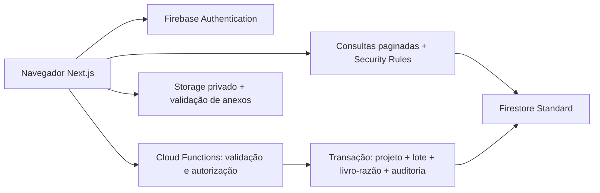

# Arquitetura

O navegador autentica com Firebase Authentication. Consultas paginadas de cadastros, projetos e eventos usam o SDK modular do Firestore e passam pelas Security Rules. Toda alteração passa por uma Callable Function com validação Zod e autorização de vínculo.

## Organização

- `src/app`: rotas e composição das páginas.
- `src/features/catalogs`: formulários e consultas reutilizáveis dos cadastros.
- `src/features/projects`: listagem, formulário e detalhes do projeto.
- `src/features/production`: formulários operacionais.
- `src/hooks`: estado de autenticação e paginação com proteção contra respostas obsoletas.
- `functions/src/domain.ts`: contratos Zod e transições físicas de saldo.
- `functions/src/production.ts`: motor transacional, idempotência, compensação e reconciliação.
- `functions/src/index.ts`: operações callable, convites, cadastros, relatórios e anexos.

## Decisões

Controle por projeto e lote. Cor/tamanho são identificadores preservados no lote; não existem transferências entre variantes. Quarentena retém defeitos sem reinseri-los no fluxo como aprovados. Perdas e despachos são contas terminais; a soma continua reconciliável.

O corte exige modelagem liberada. Estamparia é opcional; costura, embalagem e despacho são etapas obrigatórias. Módulos personalizados são de apresentação e não podem criar transições arbitrárias de saldo. Um projeto iniciado não pode mudar suas etapas históricas.

Recebimento e inspeção usam a unidade do material. Valores decimais são validados e armazenados também como inteiros escalados por 1.000. Peças sempre usam inteiros.

O service worker oferece aviso de indisponibilidade de rede, sem cache de documentos privados nem fila offline para lançamentos de produção. Operações críticas precisam de confirmação do servidor.

Consultas do dashboard usam agregações do Firestore. Relatórios percorrem páginas de 100 registros, sem carregar automaticamente todo o histórico no navegador. Exportação e impressão refletem o conjunto carregado e informam isso na tela.
